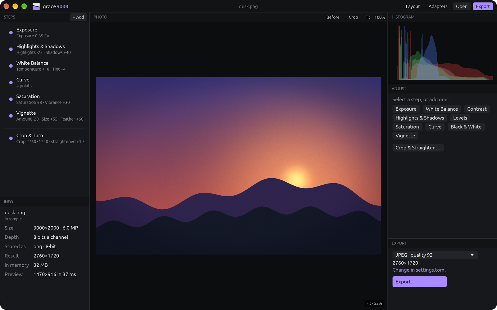

# grace9000

A bare, modular photo editor. Open a photo, add steps (exposure, curves,
white balance and the rest), crop and straighten it, export it. The photo
itself is never changed. Every panel can be moved, added or removed, the way
foobar2000 lets you rearrange its window. It's the sister of
[splice9000](https://github.com/solacecasino/splice9000), the video editor,
and [wave9000](https://github.com/solacecasino/wave9000), the audio
workstation.

It's a prototype (0.0.1): nine kinds of step, crop, straighten, turn,
mirror, export. Nothing else is in the app.

## Installing

1. Download `grace9000-<version>-macos-universal.zip` from
   [Releases](https://github.com/solacecasino/grace9000/releases) (Apple
   Silicon and Intel Macs, macOS 11 or later).
2. Unzip it and move grace9000.app to Applications.
3. The first time, **right-click → Open**: the app isn't signed with an
   Apple developer certificate, so macOS asks once.
4. Install [ffmpeg](https://ffmpeg.org) to open anything other than PNG:
   `brew install ffmpeg`. grace9000 runs it as a separate program for
   reading and writing photos, so no codecs are built in. Without it, PNG
   still opens and exports.

Windows and Linux build from the same code (`cargo build --release`) but
have no downloads yet.

## Editing a photo

1. **Drop a photo** anywhere on the window (or `cmd+o`). JPEG, PNG, TIFF,
   WebP, HEIC, AVIF and anything else your ffmpeg reads. Photos deeper than
   8 bits are kept at 16. Phone photos come in turned the way they were
   taken.
2. **Add steps** with **+ Add** in the Steps panel, the Steps menu, or the
   buttons in Adjust. Each step goes below the selected one, and they run
   top to bottom:
   Exposure, White Balance, Contrast, Highlights & Shadows, Levels,
   Saturation (with vibrance), Curve, Black & White, Vignette.
3. **Adjust** the selected step in the Adjust panel. Double-click a slider
   to reset it. In a Curve, drag a point, click to add one, double-click one
   to remove it.
4. **Arrange the steps**: drag them in the Steps panel (or `alt+↑` `alt+↓`).
   The dot turns a step off and on (`e`); `backspace` removes it; `↑` `↓`
   select. `\` shows the photo without any steps, to compare.
5. **Crop and straighten**: `c`. Drag the edges, the corners or the middle;
   pick a shape (1:1, 3:2, 16:9...) in Adjust; `[` and `]` straighten a
   little at a time. Straightening zooms in just enough that no corner comes
   up empty. `cmd+←` `cmd+→` turn it a quarter. Return when done.
6. **Look closer**: `cmd+1` shows the photo's own pixels, `cmd+0` fits it.
   `cmd`+scroll or pinch to zoom where you point; scroll or drag to move
   around; double-click to switch between the two.
7. **Export**: `cmd+e`. JPEG at quality 92 unless `settings.toml` says
   otherwise; PNG (8 or 16 bits), WebP and TIFF too. Type the extension you
   want in the save dialog. grace9000 won't write over the photo itself.

Your edit is kept as you work and comes back when you reopen grace9000,
even after a crash. `cmd+s` saves it as a small `.grace` file (readable
JSON) to keep or share; open it to get the photo back with its edit. Opening
another photo over unsaved changes puts the old edit in `previous.grace` in
the settings folder. `cmd+z` undoes anything.

## Rearranging the window

Panels sit edge to edge, divided by a single line.

- **Drag the line** between two panels to resize them.
- **Drag a panel by its header** onto the edge of another panel to sit
  beside it, or onto its middle to swap the two.
- **Right-click a header** to add a panel next to it, replace it, or remove it.
- **View → Panels** shows or hides any panel.
- **Layout** at the top (`cmd+L`) shows every panel as a block to drag.

Panels: Photo, Steps, Adjust, Histogram, Info, Export, Log, Help, Adapters.
A panel can be shown more than once.

## Adapters

grace9000 has only what you need, and adapters add the rest: commands,
panels, export formats, and steps of their own. Drop an adapter's zip on the
window to install it; grace9000 shows what it adds and what it may do first,
and never goes online itself. None come with 0.0.1. To make one, see
[docs/adapters.md](docs/adapters.md).

## Customizing

There's no settings window. Everything is in plain text files in one folder
(`cmd+,` opens it):

| File | What it holds |
|---|---|
| `settings.toml` | export format and quality, size limit, ffmpeg's path, colors, what's behind the photo |
| `keys.toml` | any key for any command (see the Help panel for the list) |
| `layout.toml` | the panels and where they are |
| `adapters/` | installed adapters |

Saved changes apply at once, with no restart. A file with a mistake falls
back to the defaults and the Log panel says what's wrong. Where it is:

- macOS: `~/Library/Application Support/grace9000`
- Windows: `%APPDATA%\grace9000`
- Linux: `~/.config/grace9000`
- or wherever `GRACE9000_CONFIG_DIR` points

## Measured

On an M-series MacBook Air, release build, 2026-10-29:

| | |
|---|---|
| Program size | 6.5 MB (Apple Silicon only; ffmpeg not included) |
| Memory, fresh start | 55 MB (physical footprint) |
| Memory, a 6 MP PNG open | 98 MB |
| Memory, a 24 MP JPEG open | 184 MB |
| CPU when idle | 0.0% |
| Preview, 1470×916, no steps | 10 ms |
| Preview, 1470×916, six steps, straightened and cropped | 33 ms |

A photo is kept in memory at its own depth, with a pyramid of smaller
copies a third its size: 4 bytes a pixel for 8-bit photos, 8 for deeper
ones, so a 24 MP photo takes 128 MB, or 256 MB at 16 bits. The preview is
made on its own thread and only the newest one is ever made, so sliders
never wait for it; it's what makes a whole step cost a few milliseconds.

## Not yet

Color management (photos are taken as sRGB; a Display P3 or Adobe RGB photo
looks a little flat), camera raw files, local edits (brushes, masks,
healing), sharpening and noise reduction (they need neighbouring pixels;
adapters can do them now with `image.render`), copying EXIF and other
metadata into exports, more than one photo at a time, Windows and Linux
downloads and CI.

## License

MIT
